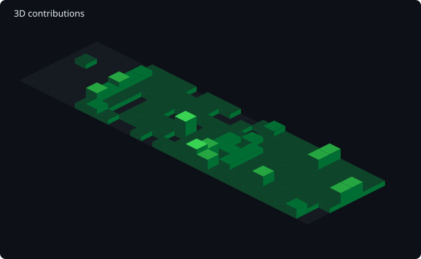
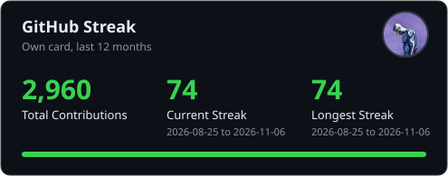
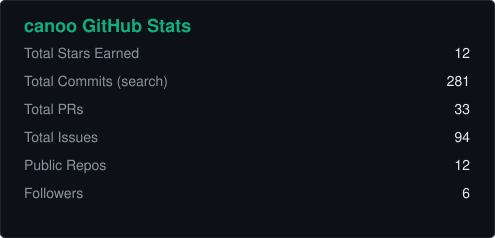
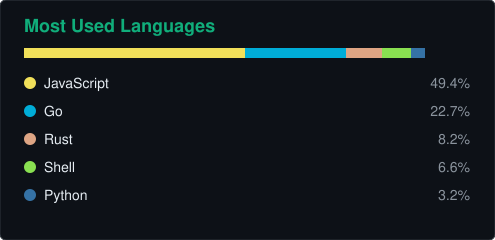
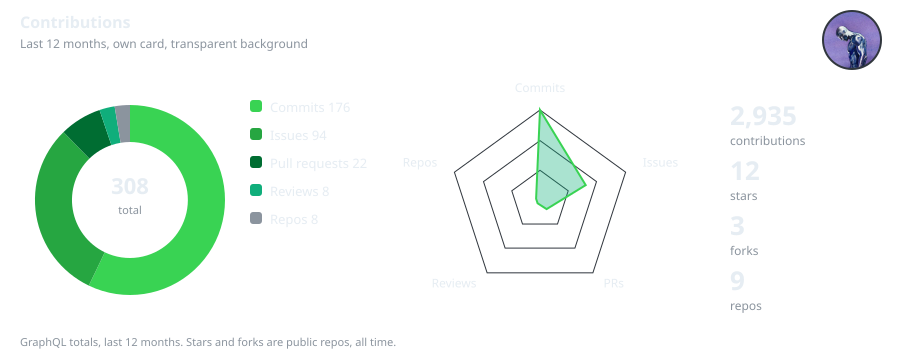

  

  

  Software developer in Canada, building full stack products and AI tooling.
  Affinity first for brand, UI design and prints.

  
  
  <!-- Add your links shortly: wrap each badge below in <a href="YOUR LINK"> ... </a> -->
  
  
  
  

## Activity

  

<table>
  <tr>
    <td valign="top" width="170">
      
    </td>
    <td valign="top">
      
    </td>
  </tr>
</table>

  

  
  

Stats cards above are generated by <a href="https://github.com/canoo/github-stats-cards">canoo/github-stats-cards</a>

  

Want these cards? Get the stats cards from <a href="https://github.com/canoo/github-stats-cards">canoo/github-stats-cards</a>, Tetris, 3D, snake, streak, and summary are coming there next

## Projects

<!-- To add a project, copy a row and link either the GitHub repo or the live site, whichever people should open. -->

| Project | What it is | Link |
|---|---|---|
| **Cibum** | Pantry tracking, expiry alerts, leftover recipes | [cibum.app](https://cibum.app) |
| **NEXUS** | AI CLI orchestration, local and cloud models, personas, TUI | [github.com/canoo/agent-nexus](https://github.com/canoo/agent-nexus) |
| **S1 Companion** | Game companion, recipe mixing, GPS map, cloud sync | [info.codelogiic.com](https://info.codelogiic.com/) |
| **La Dulce Barra** | Snack bar and event catering booking site | [ladulcebarra.party](https://ladulcebarra.party) |
| **Omniscores Timer** | Minimalist dot matrix tournament and turn clock | [info.codelogiic.com](https://info.codelogiic.com/) |

## What I actually use

TypeScript / React / Next.js, Go, Python, Firebase, Cloudflare

<!-- Snake, 3D graph and stats cards appear after their workflows run once. -->
